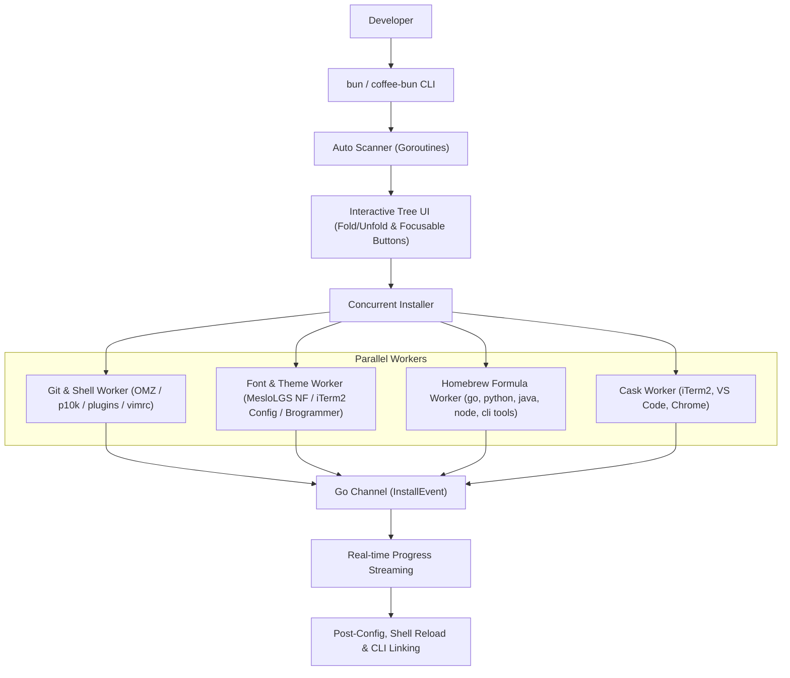

<h1 align="center">Coffee Bun</h1>

<p align="center">
  <strong>A friendly, automated cross-platform workstation setup and maintenance tool written in Go</strong>
</p>

<p align="center">
  <a href="https://github.com/KennethanCeyer/coffee-bun/actions"></a>
  <a href="https://golang.org"></a>
  <a href="https://github.com/KennethanCeyer/coffee-bun"></a>
  <a href="LICENSE"></a>
</p>

---

## The Story Behind the Name

Every developer knows the mixed feelings of setting up a brand-new workstation. You unpack the machine, open the terminal, and realize you are staring at hours of repetitive, manual setup work: installing package managers, hunting down Nerd Fonts, configuring terminal color schemes, linking the VS Code CLI, installing programming languages, configuring `.zshrc`, and fixing PATH errors when things do not link correctly.

The command name **bun** comes directly from **bundle** — taking every essential developer tool, runtime, and shell configuration and bundling them together into a single automated step.

So why **Coffee Bun**?

Because setting up your development workstation should not feel like troubleshooting a broken build. It should be a moment where you step away from the keyboard, brew a fresh cup of hot coffee, grab a warm coffee bun, and relax.

While you enjoy your break, **Coffee Bun** takes care of the heavy lifting in the background across **macOS**, **Linux**, and **Windows**.

---

## Cross-Platform Support

| Platform | Native Package Managers | Fonts Directory | Supported Features |
| :--- | :--- | :--- | :--- |
| **macOS** (`darwin`) | Homebrew (`brew` formulae & casks), `xcode-select` | `~/Library/Fonts` | Full suite + iTerm2 + Chrome Default Browser + `.zshrc` |
| **Linux** (`linux`) | `apt-get`, `dnf`, `apk`, or Linuxbrew (`brew`) | `~/.local/share/fonts` | Toolchains, Fonts, OMZ/p10k, Vim, Languages, Cloud & Modern CLIs, Desktop Apps |
| **Windows** (`windows`) | `winget` & Chocolatey (`choco`) | `%LOCALAPPDATA%\Microsoft\Windows\Fonts` | Git, Fonts, Vim Runtime, Languages, Cloud & Modern CLIs, VS Code, Chrome |

---

## Features

- **Automatic Environment Inspection**: Probes all tools, versions, and application paths concurrently on launch, automatically filtering packages to those supported on your current OS.
- **Interactive Tree UI with Vim Navigation**:
  - Organizes packages into logical, foldable categories (`[-]` unfolded / `[+]` folded).
  - Full **Vim-style navigation**: `j`/`k`, `g`/`G` (jump to top/bottom), `Ctrl+d`/`Ctrl+u` or `J`/`K` (half-page scroll), `H`/`M`/`L` (screen top/middle/bottom), `h`/`l` (fold/unfold or jump to parent category), `o`/`c` or `f`/`z` (expand/collapse all groups), and `?` (in-app keyboard shortcuts manual).
- **Focusable Action Bar**:
  - Bottom action bar with `[ < Exit ]` and `[ Start Install (N) > ]` buttons navigable via `Tab`, `Shift+Tab`, or arrow keys.
- **Concurrent Installations with Live Stream Output**:
  - Independent Git clones, font downloads, and package manager installations run concurrently with real-time progress streaming.
- **Friendly Prerequisite & Sudo Watcher**:
  - When manual or elevated actions are needed, Coffee Bun explains **Why** the action is needed, **How** to complete it, and provides the exact copyable **Cmd**, polling every 2 seconds to resume automatically once complete.
- **System Diagnostics (`bun doctor`) & One-Stop Upgrader (`bun update`)**:
  - Inspects your OS environment, package manager health, `.zshrc` theme, `zoxide` hook, and `code` CLI link.

---

## What's Bundled

| Category | Component | Description & Integration |
| :--- | :--- | :--- |
| **System & Toolchains** | [Xcode Command Line Tools](https://developer.apple.com/) | macOS developer tools, compilers, and SDK headers (`xcode-select`, macOS) |
| | [Homebrew](https://brew.sh/) | Package manager (`brew`, macOS) |
| | [Git](https://git-scm.com/) | Distributed version control system |
| **Terminal & Shell** | [iTerm2](https://iterm2.com/) | macOS terminal emulator with split panes and tabs (macOS) |
| | [MesloLGS NF Font](https://github.com/romkatv/powerlevel10k-media) | Powerlevel10k Nerd Font installed into your OS user fonts directory |
| | iTerm2 Font Setting | Configures default profile to `MesloLGS-NF-Regular 16` (macOS) |
| | [Brogrammer Theme](https://github.com/mbadolato/iTerm2-Color-Schemes) | High-contrast color preset for iTerm2 (macOS) |
| | [Oh My Zsh](https://github.com/ohmyzsh/ohmyzsh) | Community-driven zsh configuration framework (macOS & Linux) |
| | [Powerlevel10k](https://github.com/romkatv/powerlevel10k) | Fast, flexible prompt theme (macOS & Linux) |
| | [zsh-autosuggestions](https://github.com/zsh-users/zsh-autosuggestions) | Fish-shell style command autocompletion suggestions (macOS & Linux) |
| | [zsh-syntax-highlighting](https://github.com/zsh-users/zsh-syntax-highlighting) | Real-time command syntax highlighting (macOS & Linux) |
| **Cloud & DevOps CLIs** | [AWS CLI](https://aws.amazon.com/cli/) | Unified command-line interface for AWS services |
| | [Google Cloud SDK](https://cloud.google.com/sdk) | `gcloud` CLI tools and libraries |
| | [Azure CLI](https://learn.microsoft.com/cli/azure/) | `az` command-line tools for Microsoft Azure |
| **Editors & Vim** | [Ultimate Vim Runtime](https://github.com/amix/vimrc) | Awesome vim configuration (`amix/vimrc`) with plugins |
| | [Visual Studio Code](https://code.visualstudio.com/) | Code editor + **automatic `code` CLI PATH linking** |
| | [VS Code CLI (`code`)](https://code.visualstudio.com/docs/editor/command-line) | Linked binary in PATH for command-line editing |
| **Compilers & Languages**| [Go](https://go.dev/) | High-performance open-source systems language |
| | [Python 3](https://python.org/) | Python interpreter bundled with `pip` |
| | [Java (OpenJDK)](https://openjdk.org/) | Open-source reference implementation of Java SE |
| | [GCC / Clang](https://gcc.gnu.org/) | GNU Compiler Collection & system C/C++ toolchain |
| | [Node.js](https://nodejs.org/) | JavaScript runtime engine bundled with `npm` |
| **Modern CLI Tools** | [zoxide](https://github.com/ajeetdsouza/zoxide) | Smarter `cd` command with frecency directory jumping |
| | [htop](https://htop.dev/) | Interactive process viewer and resource monitor (macOS & Linux) |
| | [fzf](https://github.com/junegunn/fzf) | Command-line fuzzy finder with shell keybindings |
| | [ripgrep](https://github.com/BurntSushi/ripgrep) | Ultra-fast recursive line search (`rg`) |
| | [eza](https://github.com/eza-community/eza) | Modern, colorful replacement for `ls` |
| | [tree](https://oldmanprogrammer.net/source.php?dir=projects/tree) | Depth-indented recursive directory listing |
| | [jq](https://jqlang.github.io/jq/) | Command-line JSON processor |
| | [bat](https://github.com/sharkdp/bat) | Cat clone with syntax highlighting and Git integration |
| **Essential Apps & Settings** | [Google Chrome](https://www.google.com/chrome/) | Modern, secure web browser |
| | Chrome Default Browser | Sets Google Chrome as default system browser (macOS) |

---

## Installation

### 1. macOS & Linux (One-Line Bootstrap)

```bash
curl -fsSL https://raw.githubusercontent.com/KennethanCeyer/coffee-bun/main/install.sh | bash
```

---

### 2. Windows PowerShell (One-Line Bootstrap)

```powershell
irm https://raw.githubusercontent.com/KennethanCeyer/coffee-bun/main/install.ps1 | iex
```

---

### 3. Build from Source

```bash
git clone https://github.com/KennethanCeyer/coffee-bun.git
cd bundle
make install
```

> **Note:** Both `bun` and `coffee-bun` are available in your PATH after installation.

---

## Usage

### Interactive Tree Mode (TUI)

Simply run `bun` (or `coffee-bun`) in your terminal:

```bash
bun
```

```text
        ▄▄██████▄▄         ▄▀▀▀ ▄▀▀▄ █▀▀▀ █▀▀▀ █▀▀▀ █▀▀▀
     ▄██▀▀▀▀▀▀▀▀▀▀██▄      █    █  █ █▀▀  █▀▀  █▀▀  █▀▀ 
    ██▀ ▄▄██████▄▄ ▀██     ▀▄▄▄ ▀▄▄▀ ▀    ▀    ▀▄▄▄ ▀▄▄▄
   ██▀ ██▀▀▀▀▀▀▀▀██ ▀██    █▀▀▄ █  █ █▄ █
  ▄██▄▄████████████▄▄██▄   █▀▀▄ █  █ █ ▀█
   ▀▀▀▀▀▀▀▀▀▀▀▀▀▀▀▀▀▀▀▀    ▀▀▀   ▀▀  ▀  ▀

  > [-] [shell] Terminal & Shell (iTerm2, Fonts, OMZ, p10k) (6/8 installed) [All]
      [x] iTerm2                   3.7.6            - Terminal emulator for macOS
      [x] MesloLGS NF Font         Installed        - Nerd Font with icons
      [ ] iTerm2 Font Config       missing          - Configure iTerm2 default font
      [x] Brogrammer Theme         Preset Ready     - High-contrast aesthetic theme
      [x] Oh My Zsh                964ddf7          - Community zsh framework
      [x] Powerlevel10k            d05a1b0          - Fast, aesthetic zsh theme
      [x] Zsh Autosuggestions      v0.7.1           - Fish-like autosuggestions
      [x] Zsh Syntax Highlighting  0.8.0            - Syntax highlighting

  ------------------------------------------------------------------------
  [ < Exit ]                                    [ Start Install (3) > ]
  [j/k] Move  [g/G] Top/Bot  [h/l] Fold  [Space] Toggle  [m] Missing  [?] Help  [q] Quit
```

#### Keyboard & Vim Controls:
- **`j` / `k` or `Down` / `Up`**: Move cursor down / up.
- **`g` / `G` or `Home` / `End`**: Jump to the very first (`g`) or very last (`G`) item.
- **`Ctrl+d` / `Ctrl+u` or `J` / `K`**: Scroll half-page down / up.
- **`H` / `M` / `L`**: Jump to the top, middle, or bottom of the visible viewport.
- **`h` / `l` or `Left` / `Right`**: Fold (`[+]`) or unfold (`[-]`) category groups; pressing `h` on a child item jumps to its parent category.
- **`o` / `c` or `f` / `z`**: Open (unfold) all groups (`o`), close (fold) all groups (`c`), or toggle all folds (`f`/`z`).
- **`Space`**: Toggle selection for an individual package or an entire category group.
- **`m` / `a` / `x`**: Select all missing packages (`m`), toggle all (`a`), or clear all selections (`x`).
- **`Tab` / `Shift+Tab`**: Cycle focus between the package tree and the bottom action buttons.
- **`?`**: Open/close the interactive keyboard shortcuts manual.
- **`q` / `Esc`**: Exit the application.


---

### System Inspection (`bun check`)

Inspect what is installed and check current versions:

```bash
bun check
```

---

### Non-Interactive Installation (`bun install`)

Ideal for provisioning scripts, dotfiles, or fresh machines:

```bash
# Install all missing tools
bun install all

# Install specific domain
bun install terminal
bun install vim
bun install languages
bun install cli
bun install apps

# Install specific packages by name
bun install vim-runtime java zoxide
```

---

### Update & Maintenance (`bun update`)

Concurrently update Homebrew packages, casks, and pull latest commits for Oh My Zsh, Powerlevel10k, and plugins:

```bash
bun update
```

---

### System Diagnostics (`bun doctor`)

Validate configuration files (`~/.zshrc`), PATH settings, and whether the `code` CLI is linked:

```bash
bun doctor
```

```text
 coffee-bun doctor - Diagnostic Report 

  [OK] OS: macOS (darwin/arm64)
  [OK] Homebrew: Installed and in PATH
  [OK] VS Code CLI (`code`): Configured and accessible
  [OK] Powerlevel10k: Active theme configured in ~/.zshrc
  [OK] Zoxide: Shell hook configured in ~/.zshrc
```

---

### Customization & Enterprise Setup (`bun.yaml`)

coffee-bun supports organization and project-level customization via declarative YAML configuration. You can add internal company CLIs, custom VPNs, private registries, team stack presets, and lifecycle hooks without modifying any Go code.

Place a `bun.yaml` file in your repository, home directory (`~/.config/coffee-bun/bun.yaml`), or enterprise MDM path (`/etc/coffee-bun/bun.yaml`):

```yaml
version: "1.0"
hooks:
  post_install: |
    git config --global user.email "$(whoami)@acme.corp"

groups:
  - category: "Acme Internal"
    title: "Corporate Developer Tools"
    packages:
      - acme-cli
      - acme-vpn

packages:
  - id: acme-cli
    name: "Acme CLI"
    description: "Internal microservices orchestrator"
    category: "Acme Internal"
    type: "brew_formula"
    brew_name: "acme-corp/tap/acme-cli"
    binary_name: "acme"

  - id: acme-vpn
    name: "Corporate WireGuard VPN"
    description: "Enterprise VPN tunnel profile"
    category: "Acme Internal"
    type: "script"
    check_cmd: "scutil --nc status 'AcmeVPN'"
    install_cmd: "curl -fsSL https://internal.acme.corp/vpn.sh | bash"
    requires_sudo: true
```

You can also pass a custom configuration path explicitly:

```bash
bun --config ./team-bun.yaml
bun check --config ./team-bun.yaml
```

For the complete schema specification, MDM zero-touch deployment guides, and Go module extension patterns, see the [Customization & Enterprise Guide](docs/CUSTOMIZATION.md).

---

## Architecture & Concurrency



---

## Development

```bash
# Run unit tests
make test

# Build binary
make build

# Install locally to ~/.local/bin
make install
```

---

## License

This project is licensed under the [MIT License](LICENSE).
